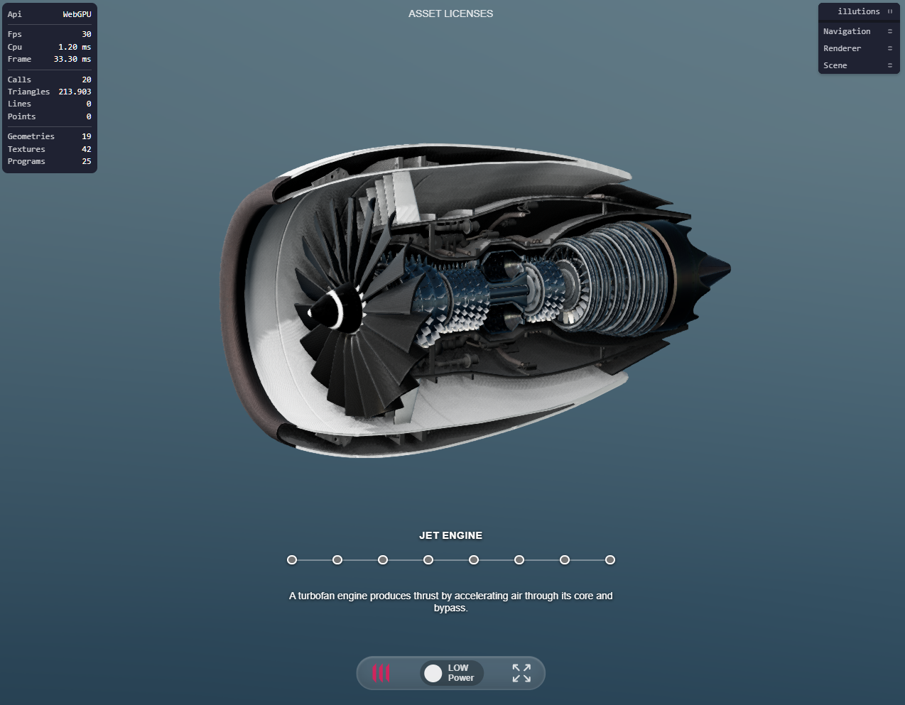

# Illutions Engine Interactive Example

This example presents an opened jet engine in cutaway view with eight interactive components. Each component can be explored directly on the 3D model or through a synchronized HTML stepper and is highlighted through its material.

## Live demo

[](https://illutions.github.io/public-interactive/)

**[Launch the interactive demo](https://illutions.github.io/public-interactive/)**
and hover over the exposed engine parts or stepper points to inspect the eight components.

## What this example demonstrates

- An opened jet engine presented as an interactive cutaway model
- Pointer-based raycasting for selecting eight exposed engine components
- A custom HTML stepper synchronized with direct 3D object interaction
- XState-powered hover states that keep exactly one component active
- Emissive material highlighting for the active engine component
- Orbit controls for rotating and inspecting the engine
- Direct Draco-compressed GLB loading, EXR environment lighting, and RectAreaLight support
- SSR post-processing and antialiased WebGL rendering configured through TypeScript
- Runtime controls for inspecting and tuning the experience
- A focused project structure that is easy to use as a starting point

## Why Illutions Engine

Illutions Engine brings the pieces needed for sophisticated browser-based 3D
applications into one configurable workflow:

- **Advanced post-processing**  
Add SSAO, SSR, FXAA and SMAA through configurable pipelines for WebGL and WebGPU.

- **Advanced animation control**  
Coordinate GLTF animation clips, GSAP transitions, camera paths and custom dolly-rig camera workflows.

- **XState-powered application logic**  
Model complex application flows as predictable and inspectable state machines with integrated XState 5 usage.

- **Resource-aware rendering**  
An intelligent, configurable FPS limiter avoids unnecessary frames and helps reduce CPU and GPU load.

- **WebGL and WebGPU rendering**  
Support established and next-generation browser rendering with automatic WebGPU selection and WebGL fallback.

- **Lean initial bundles**  
Optional controls, loaders, inspectors and effects are dynamically imported only when needed.

- **Optimized GLTF/GLB pipeline**  
Load assets with Draco or Meshopt mesh compression and WebP or KTX2 textures.

- **Built-in interaction and audio**  
Use pointer-based raycasting and distance-aware spatial audio.

- **Flexible environments**  
Load HDR, EXR and texture environments with configurable rotation, intensity and background controls.

- **Runtime insights and debugging**  
Inspect runtime properties, FPS, CPU and renderer statistics with detailed state, event and console reporting.

## Requirements

- Node.js and npm
- A browser with WebGL support

## Installation

```bash
npm install
```

## Development

Start the development server:

```bash
npm run dev
```

The application is served over HTTP at:

```text
http://localhost:5173
```

## Type checking

```bash
npx tsc --noEmit
```

## Build

Create a production build:

```bash
npm run build
```

The generated files are written to `dist/`.

## Preview

Preview the production build locally:

```bash
npm run preview
```

## License

The example code and project configuration are licensed under the
[Illutions Example Code License](LICENSE.md).

The illutions Engine and illutions-provided build tooling are proprietary
software and are licensed separately. Their complete licensing terms are
provided with the [illutions package on npm](https://www.npmjs.com/package/illutions).
Build permissions are determined by `license/license.json`.

Production builds include the applicable Engine and bundled dependency
licenses in `dist/licenses.md`.

## Deployment

The included GitHub Actions workflow automatically builds and deploys the
project to GitHub Pages on every push to the `main` branch. It can also be
started manually from the Actions tab.

In the repository settings under **Pages**, select **GitHub Actions** as the
deployment source. The workflow provides Vite with the GitHub Pages base path,
while local development continues to use the domain root `/`.

## Third-party assets

Third-party assets remain subject to their respective licenses. See
[Asset Licenses](public/LICENSE_ASSETS.md) for authors, sources, license terms,
and bundled-file details.

## Project structure

```text
src/       Application source code and Illutions configuration
public/    Models, environment maps, and layout assets
style/     Global application styles
license/   Illutions license data
```
